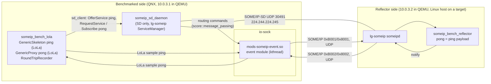
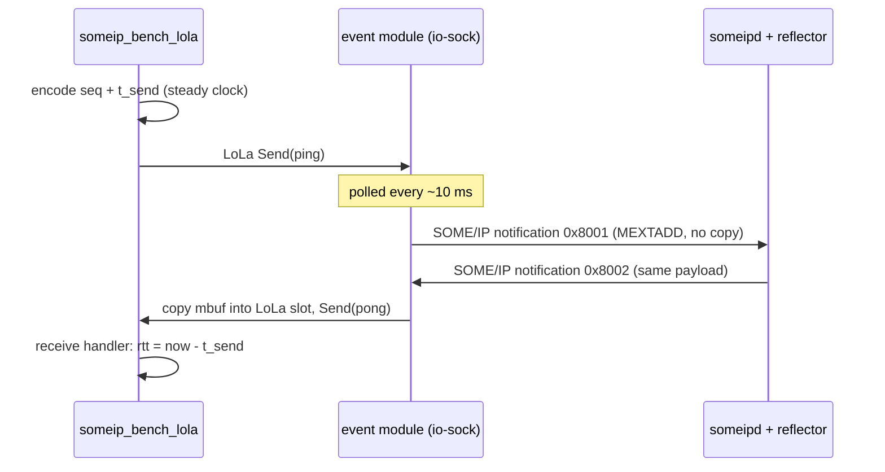

<!--
*******************************************************************************
Copyright (c) 2026 Contributors to the Eclipse Foundation

See the NOTICE file(s) distributed with this work for additional
information regarding copyright ownership.

This program and the accompanying materials are made available under the
terms of the Apache License Version 2.0 which is available at
https://www.apache.org/licenses/LICENSE-2.0

SPDX-License-Identifier: Apache-2.0
*******************************************************************************
-->

# SOME/IP round-trip benchmark

The benchmark measures the resource consumption, latency and throughput of SOME/IP event
transport through the io-sock event module. The wire contract is stack independent, so the same
reflector can measure other SOME/IP stacks, e.g. an AUTOSAR ara::com stack.

The benchmarked side publishes **ping** events. A remote reflector on the upstream lg-someip
stack echoes every ping unchanged as a **pong** event. The reflector and the wire contract are
the same for every stack, so only the benchmarked side differs between measurements.

## Architecture



One round trip:



### Wire contract ([bench_protocol.h](bench_protocol.h))

| Direction | Service | Instance | Eventgroup | Event | Provider |
| --- | --- | --- | --- | --- | --- |
| ping | 0xB001 | 0x0001 | 0x0001 | 0x8001 | benchmarked side |
| pong | 0xB002 | 0x0001 | 0x0002 | 0x8002 | reflector |

- Plain events (not fields) over UDP, interface version 0.0.
- SOME/IP payload is 12..1400 bytes. The payload starts with a 12 byte big-endian header: u32
  sequence number and u64 send time in ns. Only the sender's steady clock is used, so the two
  sides need no clock synchronization.
- SD uses port 30491 and group 224.244.224.245, so it does not collide with another SOME/IP stack
  on the default 30490. `run_host_reflector.sh` takes the SD endpoint of other stacks as
  arguments.

### Benchmark application

`someip_bench_lola [options]`:

| Option | Default | Meaning |
| --- | --- | --- |
| `--run <payload>:<rate_hz>:<count>` | required, repeatable | One measurement run, paced at `rate_hz` |
| `--warmup <n>` | 50 | Pings before each run that are not measured |
| `--setup-timeout <s>` | 30 | Time for discovery and the first reflected ping |
| `--label <name>` | `iosock` | Label in the results |
| `--mw-com-config <path>` | `./etc/mw_com_config.json` | LoLa deployment |
| `--samples <path>` | none | Writes `<payload> <rate_hz> <sequence> <rtt_ns>` per received pong |

Setup is complete when the first pong has arrived, which means both subscriptions are active.
All runs then execute in one process. Each run prints one line:

```text
BENCH_RESULT {"label":"iosock","payload":16,"rate_hz":100,"sent":300,"send_failed":0,"received":300,
              "lost":0,"duplicates":0,"rtt_us":{"min":..,"p50":..,"p90":..,"p99":..,"p999":..,"max":..,"mean":..}}
```

Benchmark applications for other stacks use the same options and output format, so their results
can be compared directly.

## Run locally (two QNX QEMU VMs)

Prerequisites, as for the other QNX tests of this repository:

- KVM.
- qnx.com credentials in `~/.netrc` for the QNX SDP download.
- A QNX license (`QNXLM_LICENSE_FILE`, see the root `.bazelrc`).

```sh
bazel test --config=qnx_x86_64 //experimental/someip_sd/benchmark:someip_bench_dual_qemu_test \
    --test_output=all --nocache_test_results
```

[test_bench_qemu.py](test_bench_qemu.py) does the following:

1. VM-B (10.0.3.2, filesystem `:bench_peer_apps` under `/opt/someip_bench_peer`) starts
   `someipd` and `someip_bench_reflector` with [config/lg_reflector.json](config/lg_reflector.json).
2. VM-A (10.0.3.1, filesystem `:bench_sd_apps` under `/opt/someip_sd`) runs
   [target/run_target.sh](target/run_target.sh). This is the same script as on a real target. It:
   1. loads `mods-someip-event.so` with `mount -T io-sock`;
   2. waits for `event task started` in `slog2info`;
   3. starts `someip_sd_daemon`;
   4. runs `someip_bench_lola` with `--run 16:100:300 --run 1400:100:300 --warmup 20`.
3. The test checks that every run received pongs, at most 1 % were lost and there were no
   duplicates. It prints the `BENCH_RESULT` lines. On failure it prints the logs of the module,
   io-sock, the SD daemon and the peer.

The test is a functional check, not a measurement. QEMU timing is not representative, and the
module's 10 ms polling dominates the round trip: p50 is about 17 ms.

Results after the test:

| File | Content |
| --- | --- |
| `bazel-testlogs/experimental/someip_sd/benchmark/someip_bench_dual_qemu_test/test.outputs/results.jsonl` | One JSON object per run (the `BENCH_RESULT` payload) |
| `.../test.outputs/hogs.txt` | CPU samples per process, only if the image provides `hogs` (the QEMU image does not) |
| `.../test.log` | Full console log, including the `BENCH_RESULT` lines and the diagnostics printed on failure |

Different runs: change `RUNS` in [test_bench_qemu.py](test_bench_qemu.py).

## Mixed load benchmark

The mixed load benchmark replays a realistic event mix instead of a single ping/pong stream. Both
directions run concurrently. The input is
[config/someip_event_workload.csv](config/someip_event_workload.csv). Each row is an event class
(`direction`, `frequency_bucket`, `payload_bucket`). The direction is seen from the benchmarked
side: TX events are published by `someip_load_lola`, RX events by the remote `someip_load_peer`.

[gen_load_workload.py](gen_load_workload.py) turns every class into `streams` synthetic events:

| CSV column | Synthetic event |
| --- | --- |
| `frequency_bucket` | Rate per event: `<1 Hz` → 1, `1-<10 Hz` → 5, `10-<50 Hz` → 20, `50-<100 Hz` → 50, `>=100 Hz` → 100, `Unknown/nonperiodic` → 1 Hz |
| `max_payload_bytes` | Payload size, at least 12 B (header of [bench_protocol.h](bench_protocol.h)). TODO: capped at 1400 B until SOME/IP-TP is implemented |
| `streams` | Number of events of the class |

The events of a class are grouped into services of at most 64 events (TX 0xC000…, RX 0xD000…), one
eventgroup each. The generator also writes the configurations: `mw_com_config.json` and
`sd_daemon.json` for the benchmarked side and `lg_load_peer.json` for the peer. The current CSV
yields 501 TX streams (about 2.2k events/s) and 455 RX streams (about 4.2k events/s).

Both applications send with a paced scheduler: fixed rate per event, phases spread over the period.
The sequence number marks TX samples that are sent within the measurement window, so the TX loss is
exact. RX loss is counted from sequence gaps. Each application prints one line per class:

```text
LOAD_RESULT {"label":"iosock","side":"sd","class":30,"direction":"TX","frequency":"10-<50Hz","payload_bucket":"0-64B",
             "csv_max_payload":50,"payload":50,"rate_hz":20,"streams":28,"sent":11200,"send_failed":0,"max_send_lag_us":..}
LOAD_RESULT {"label":"lg-someip","side":"peer","class":30,...,"streams_received":28,"received":11200,"lost":0,
             "duplicates":0,"jitter_us":{"p50":..,"p99":..,"max":..}}
```

The peer sends RX continuously, so its `sent` counts all samples since its start. RX loss refers to
the samples received within the window. `jitter_us` is the deviation of the inter-arrival time from the period. One-way latency is not
measured, because the clocks of the two sides are not synchronized.

`someip_load_lola [options]` (started by `run_target.sh --app someip_load_lola`):

| Option | Default | Meaning |
| --- | --- | --- |
| `--workload <path>` | `./etc/workload.txt` | Generated workload |
| `--duration <s>` | 20 | Measurement window |
| `--warmup <s>` | 5 | Load before the window, after every RX stream delivered a sample |
| `--setup-timeout <s>` | 60 | Time for discovery and the first sample of every RX stream |
| `--scale <factor>` | 1.0 | Multiplies all rates; use the same value for the peer |
| `--cpu-baseline <s>` | 5 | Idle CPU window before any service is offered; 0 disables it |
| `--cpu-scales <f,f>` | none | CPU sweep after the warmup: one window per factor (relative to `--scale`, at most 7); use the same list for the peer |
| `--cpu-phase <s>` | 10 | Length of each sweep window, after 1 s to settle |
| `--cpu-process <name>` | | Further process to sample, besides `io-sock` and `someip_sd_daemon` (repeatable) |
| `--label`, `--mw-com-config` | as `someip_bench_lola` | |

`someip_load_peer <lg-someip config> [--workload <path>] [--scale <factor>] [--cpu-scales <f,f>] [--label lg-someip]`
publishes until SIGINT/SIGTERM and then prints its results.

Run on two QNX QEMU VMs (prerequisites as above):

```sh
bazel test --config=qnx_x86_64 //experimental/someip_sd/benchmark:someip_load_dual_qemu_test \
    --test_output=all --nocache_test_results
```

[test_load_qemu.py](test_load_qemu.py) starts `someipd` and `someip_load_peer` on VM-B
(`:load_peer_apps` under `/opt/someip_load_peer`). It then runs `run_target.sh --app someip_load_lola`
on VM-A (`:load_sd_apps` under `/opt/someip_load`), stops the peer and prints one table row per
class. It checks that every class was sent and received without duplicates. Loss and jitter are only
printed. `test.outputs/results.jsonl` holds the `LOAD_RESULT` lines of both sides. To change the
load, change `SCALE`, `DURATION_S` or the CSV.

### CPU load of the event module

`hogs` is missing on the QEMU image and only resolves processes, while the module runs inside
io-sock. [cpu_sampler.h](cpu_sampler.h) therefore reads the CPU time per thread from QNX procfs
(`DCMD_PROC_TIDSTATUS`, system + user time) at the start and end of each window, and groups the
deltas:

| Group | Threads |
| --- | --- |
| `module` | The event module's kthread in io-sock (`someip_event`). `run_target.sh` passes its tid from the module log (`event task started (tid N)`) in `SOMEIP_EVENT_MODULE_TID`; without it the sampler matches the thread name |
| `io-sock` | All other io-sock threads: network stack, driver interrupt and queue threads, resource manager |
| `idle` | The idle threads of procnto, one per CPU; busy = CPUs × window − idle |
| process name | `someip_sd_daemon`, the application itself and every `--cpu-process` |

The module receives in its own thread (the socket upcall only marks it pending), so `module` covers
its TX and RX work. The protocol stack below the socket API runs in the other io-sock threads.

`someip_load_lola` measures in one process, because a restarted LoLa provider is not picked up by
the module (see Limitations):

1. Accounting check: busy-waits 200 ms and prints the CPU time procfs accounted for it.
2. Baseline: `--cpu-baseline` seconds before any service is offered.
3. Sweep: after the warmup, one window per `--cpu-scales` factor. The TX sequence numbers carry the
   phase (bits 28..30), and the peer switches its RX rates when it receives it.
4. The main window at full load.

Each window prints a `CPU_RESULT` line with the events sent and received in it, CPU ms and % of one
CPU per group, and the io-sock threads that used CPU. `someip_bench_lola` prints one per run as well.
[test_load_qemu.py](test_load_qemu.py) passes `CPU_SCALES = (0.25, 0.5)`, prints a table per window
and fits a line over all windows for `module` and `io-sock`: fixed CPU % plus µs CPU per event.
`test.outputs/cpu.jsonl` holds the `CPU_RESULT` lines.

```text
       phase    ev/s     module %    io-sock %  sd daemon %        app %  busy % module us/ev
    baseline       0         0.00         0.12         0.05         0.01     0.4            -
  scale 0.25    1602         2.17         0.81         0.04         0.93     4.5        13.55
   scale 0.5    3204         3.51         1.21         0.04         1.50     6.9        10.96
        load    6409         6.56         2.03         0.03         2.58    11.9        10.24
module: 0.26 % fixed + 10.00 us CPU per event
io-sock: 0.23 % fixed + 2.90 us CPU per event
```

On QEMU (1 emulated CPU) the absolute values are not representative; compare trends, ratios and
fixed versus per-event cost. On a target, check the accounting line first. The sampler needs read
access to `/proc/<pid>/as` of io-sock (root). It is not supported on Linux, where the applications
print no `CPU_RESULT`.

## Measure on a QNX target

```sh
bazel build --config=qnx_arm64 //experimental/someip_sd/benchmark:target_bundle   # someip_sd/{bin,etc,scripts}
bazel build //experimental/someip_sd/benchmark:host_bundle                        # someip_bench_peer/{bin,etc,scripts}
```

To build `host_bundle` for an aarch64 host, add `--config=linux_arm64_gcc_12`.

Requirements on the target:

- io-sock must be allowed to load the module and to attach the module's control server path
  `/mw_com/message_passing/someip_event_module`. With a QNX security policy (secpol) that does not
  grant this, `mount -T io-sock` fails with a misleading "Exec format error".
- The bundle needs a writable and executable location. On QNX, `/tmp` is often `/dev/shmem`,
  where no directories can be created.

Steps:

1. Copy `target_bundle` to the target and unpack it (`scp -O` if the target's sshd has no SFTP).
2. On the Linux peer, in the target's subnet, run
   `someip_bench_peer/scripts/run_host_reflector.sh <host_ip> <interface> [<sd_multicast> <sd_port> [<rx_port>]]`.
   If the SD group is not routed through `<interface>` yet, the script adds a route, which needs root. If another
   user owns `/tmp/someip`, it runs lg-someip in a private mount namespace; set `SOMEIP_BENCH_PEER_WORK` if
   `/tmp/someip_bench_peer` belongs to another user too.
3. On the target:

   ```sh
   SOMEIP_BENCH_WORK=<work_dir> /bin/sh <bundle>/someip_sd/scripts/run_target.sh <target_ip> \
       [--disable-firewall] [--stop <process>] [--sd-multicast <ip> --sd-port <port>] [--rx-port <port>] \
       [--capture <interface>] [--run 16:100:1000 ...]
   ```

   - Results (including `CPU_RESULT`, see [CPU load of the event module](#cpu-load-of-the-event-module)) go to
     `$SOMEIP_BENCH_WORK/results.txt` and CPU samples (`hogs`, if available) to
     `$SOMEIP_BENCH_WORK/hogs.txt`. Without `SOMEIP_BENCH_WORK` the files are
     `/tmp/someip_bench_*`.
   - The RTT includes the network and the peer. `--capture <interface>` records UDP on the target's interface
     with `tcpdump` (`capture.pcap`) and the RTT per ping (`samples.txt`). [target_time.py](target_time.py)
     pairs them by sequence number and reports the time spent on the target (RTT minus the time between ping
     and pong on the interface): `target_time.py capture.pcap samples.txt`. Use `--payload-offset 4` for
     benchmark applications whose payload starts with a length field (Vector stack).
   - At the end the script prints the module log and the secpol violations of io-sock, the input
     for the secpol rules the module needs.
   - Measure all stacks with the same pf setting.
   - Networks that only forward configured flows (e.g. an ECU switch configured from the vehicle network)
     drop the default SD endpoint and event ports. Use an SD endpoint and ports from the network
     configuration: `--sd-multicast`/`--sd-port`, `--rx-port` on the target and `<rx_port>` on the
     peer. If another SD daemon owns that endpoint, stop it with `--stop <process>`; the two cannot
     share it.
   - The module cannot be unloaded. For a fresh measurement, restart io-sock or the target.
   - ssh may forward `LANG` and `LC_*` (e.g. `C.UTF-8`, `de_DE.UTF-8`), which QNX libc++ rejects with
     "can not determine global locale". `run_target.sh` sets `LC_ALL=C`; do the same when starting
     binaries by hand.

### Mixed load on a QNX target

```sh
bazel build --config=qnx_arm64 //experimental/someip_sd/benchmark:load_target_bundle  # someip_load/{bin,etc,scripts}
bazel build //experimental/someip_sd/benchmark:load_host_bundle                       # someip_load_peer/{bin,etc,scripts}
```

The requirements are the same as for the round-trip benchmark. The CPU sampler also needs read
access to `/proc/<pid>/as` of io-sock (root).

1. Copy `load_target_bundle` to the target and `load_host_bundle` to the Linux peer, and unpack them.
2. On the peer, start the load peer first:

   ```sh
   someip_load_peer/scripts/run_host_load_peer.sh <host_ip> <interface> [<sd_multicast> <sd_port>] \
       [--scale 1.0] [--cpu-scales 0.25,0.5]
   ```

3. On the target, pass the same `--scale` and `--cpu-scales`:

   ```sh
   SOMEIP_BENCH_WORK=<work_dir> /bin/sh <bundle>/someip_load/scripts/run_target.sh <target_ip> --app someip_load_lola \
       [--disable-firewall] [--stop <process>] [--sd-multicast <ip> --sd-port <port>] \
       [--duration 20] [--setup-timeout 60] [--scale 1.0] [--cpu-scales 0.25,0.5]
   ```

   It prints the `LOAD_RESULT` and `CPU_RESULT` lines and stores them in `$SOMEIP_BENCH_WORK/results.txt`.
4. After `run_target.sh` has finished, stop the peer with Ctrl+C. It prints its results and stores
   them in `$SOMEIP_BENCH_PEER_WORK/results.txt` (default `/tmp/someip_load_peer`). The peer
   accumulates over its lifetime, so use one peer run per target run.
5. Copy the target's `results.txt` to the peer and print the tables of the QEMU test:
   `python3 someip_load_peer/scripts/load_report.py <target results.txt> <peer results.txt>`.

Notes:

- The workload uses one event port per service: target providers 31000 + n and consumers 32000 + n,
  peer providers 33000 + n and consumers 34000 + n, for service number n. Networks that only
  forward configured flows can use single-port mode instead: `--rx-port <port>` on
  `run_target.sh` moves all target consumers to one port, and `--rx-port <port>` on
  `run_host_load_peer.sh` does the same for the peer. Events are still routed by service and
  instance. On IPNext hardware this was run with the target on 31338 and the peer on 34501:

  ```sh
  # target
  run_target.sh <target_ip> --disable-firewall --stop someipd_posix \
      --sd-multicast 239.192.255.251 --sd-port 30490 --rx-port 31338 \
      --app someip_load_lola --cpu-scales 0.25,0.5
  # peer
  run_host_load_peer.sh <host_ip> <interface> 239.192.255.251 30490 --rx-port 34501 \
      --cpu-scales 0.25,0.5
  ```
- The module serves the services of the bundle it was loaded from (`etc/mw_com_config.json` next to
  its `bin`). `run_target.sh` refuses to run if io-sock already holds a module from another bundle,
  e.g. after a round-trip measurement. Restart io-sock or the target in between.
- Start the peer before the target, so that every RX stream delivers within `--setup-timeout`.

## Limitations

- The module polls every ~10 ms, which dominates the latency. Event-driven wakeups are not
  implemented yet.
- UDP events only, no TCP or methods. The benchmark will be extended once they are supported.
- TX copies payloads up to 2 KB into the mbuf. Larger payloads are sent zero-copy and keep their LoLa
  sample until the driver frees the mbuf; drivers that free TX mbufs late (seconds on some EMACs)
  starve the module's proxy of samples.
- Restarting the local LoLa provider while the module still holds its proxy stops TX. That is why
  all runs share one process.
- The io-sock module cannot be unloaded. Reload means restarting io-sock or the VM.
