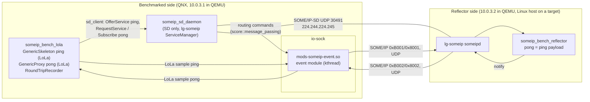
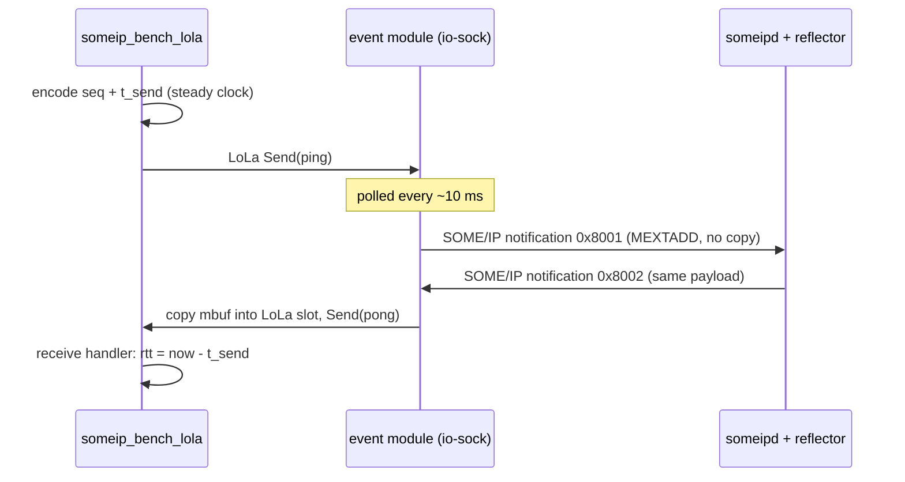

<!--
*******************************************************************************
Copyright (c) 2026 Contributors to the Eclipse Foundation

See the NOTICE file(s) distributed with this work for additional
information regarding copyright ownership.

This program and the accompanying materials are made available under the
terms of the Apache License Version 2.0 which is available at
https://www.apache.org/licenses/LICENSE-2.0

SPDX-License-Identifier: Apache-2.0
*******************************************************************************
-->

# SOME/IP round-trip benchmark

The benchmark measures the resource consumption, latency and throughput of SOME/IP event
transport through the io-sock event module. The wire contract is stack independent, so the same
reflector can measure other SOME/IP stacks, e.g. an AUTOSAR ara::com stack.

The benchmarked side publishes **ping** events. A remote reflector on the upstream lg-someip
stack echoes every ping unchanged as a **pong** event. The reflector and the wire contract are
the same for every stack, so only the benchmarked side differs between measurements.

## Architecture



One round trip:



### Wire contract ([bench_protocol.h](bench_protocol.h))

| Direction | Service | Instance | Eventgroup | Event | Provider |
| --- | --- | --- | --- | --- | --- |
| ping | 0xB001 | 0x0001 | 0x0001 | 0x8001 | benchmarked side |
| pong | 0xB002 | 0x0001 | 0x0002 | 0x8002 | reflector |

- Plain events (not fields) over UDP, interface version 0.0.
- SOME/IP payload is 12..1400 bytes. The payload starts with a 12 byte big-endian header: u32
  sequence number and u64 send time in ns. Only the sender's steady clock is used, so the two
  sides need no clock synchronization.
- SD uses port 30491 and group 224.244.224.245, so it does not collide with another SOME/IP stack
  on the default 30490. `run_host_reflector.sh` takes the SD endpoint of other stacks as
  arguments.

### Benchmark application

`someip_bench_lola [options]`:

| Option | Default | Meaning |
| --- | --- | --- |
| `--run <payload>:<rate_hz>:<count>` | required, repeatable | One measurement run, paced at `rate_hz` |
| `--warmup <n>` | 50 | Pings before each run that are not measured |
| `--setup-timeout <s>` | 30 | Time for discovery and the first reflected ping |
| `--label <name>` | `iosock` | Label in the results |
| `--mw-com-config <path>` | `./etc/mw_com_config.json` | LoLa deployment |

Setup is complete when the first pong has arrived, which means both subscriptions are active.
All runs then execute in one process. Each run prints one line:

```text
BENCH_RESULT {"label":"iosock","payload":16,"rate_hz":100,"sent":300,"send_failed":0,"received":300,
              "lost":0,"duplicates":0,"rtt_us":{"min":..,"p50":..,"p90":..,"p99":..,"p999":..,"max":..,"mean":..}}
```

Benchmark applications for other stacks use the same options and output format, so their results
can be compared directly.

## Run locally (two QNX QEMU VMs)

Prerequisites, as for the other QNX tests of this repository:

- KVM.
- qnx.com credentials in `~/.netrc` for the QNX SDP download.
- A QNX license (`QNXLM_LICENSE_FILE`, see the root `.bazelrc`).

```sh
bazel test --config=qnx_x86_64 //experimental/someip_sd/benchmark:someip_bench_dual_qemu_test \
    --test_output=all --nocache_test_results
```

[test_bench_qemu.py](test_bench_qemu.py) does the following:

1. VM-B (10.0.3.2, filesystem `:bench_peer_apps` under `/opt/someip_bench_peer`) starts
   `someipd` and `someip_bench_reflector` with [config/lg_reflector.json](config/lg_reflector.json).
2. VM-A (10.0.3.1, filesystem `:bench_sd_apps` under `/opt/someip_sd`) runs
   [target/run_target.sh](target/run_target.sh). This is the same script as on a real target. It:
   1. loads `mods-someip-event.so` with `mount -T io-sock`;
   2. waits for `event task started` in `slog2info`;
   3. starts `someip_sd_daemon`;
   4. runs `someip_bench_lola` with `--run 16:100:300 --run 1400:100:300 --warmup 20`.
3. The test checks that every run received pongs, at most 1 % were lost and there were no
   duplicates. It prints the `BENCH_RESULT` lines. On failure it prints the logs of the module,
   io-sock, the SD daemon and the peer.

The test is a functional check, not a measurement. QEMU timing is not representative, and the
module's 10 ms polling dominates the round trip: p50 is about 17 ms.

Results after the test:

| File | Content |
| --- | --- |
| `bazel-testlogs/experimental/someip_sd/benchmark/someip_bench_dual_qemu_test/test.outputs/results.jsonl` | One JSON object per run (the `BENCH_RESULT` payload) |
| `.../test.outputs/hogs.txt` | CPU samples per process, only if the image provides `hogs` (the QEMU image does not) |
| `.../test.log` | Full console log, including the `BENCH_RESULT` lines and the diagnostics printed on failure |

Different runs: change `RUNS` in [test_bench_qemu.py](test_bench_qemu.py).

## Measure on a QNX target

```sh
bazel build --config=qnx_arm64 //experimental/someip_sd/benchmark:target_bundle   # someip_sd/{bin,etc,scripts}
bazel build //experimental/someip_sd/benchmark:host_bundle                        # someip_bench_peer/{bin,etc,scripts}
```

To build `host_bundle` for an aarch64 host, add `--config=linux_arm64_gcc_12`.

Requirements on the target:

- io-sock must be allowed to load the module and to attach the module's control server path
  `/mw_com/message_passing/someip_event_module`. With a QNX security policy (secpol) that does not
  grant this, `mount -T io-sock` fails with a misleading "Exec format error".
- The bundle needs a writable and executable location. On QNX, `/tmp` is often `/dev/shmem`,
  where no directories can be created.

Steps:

1. Copy `target_bundle` to the target and unpack it (`scp -O` if the target's sshd has no SFTP).
2. On the Linux peer, in the target's subnet, run
   `someip_bench_peer/scripts/run_host_reflector.sh <host_ip> <interface> [<sd_multicast> <sd_port> [<rx_port>]]`.
   If the SD group is not routed through `<interface>` yet, the script adds a route, which needs root. If another
   user owns `/tmp/someip`, it runs lg-someip in a private mount namespace; set `SOMEIP_BENCH_PEER_WORK` if
   `/tmp/someip_bench_peer` belongs to another user too.
3. On the target:

   ```sh
   SOMEIP_BENCH_WORK=<work_dir> /bin/sh <bundle>/someip_sd/scripts/run_target.sh <target_ip> \
       [--disable-firewall] [--stop <process>] [--sd-multicast <ip> --sd-port <port>] [--rx-port <port>] \
       [--run 16:100:1000 ...]
   ```

   - Results go to `$SOMEIP_BENCH_WORK/results.txt` and CPU samples (`hogs`, if available) to
     `$SOMEIP_BENCH_WORK/hogs.txt`. Without `SOMEIP_BENCH_WORK` the files are
     `/tmp/someip_bench_*`.
   - At the end the script prints the module log and the secpol violations of io-sock, the input
     for the secpol rules the module needs.
   - Measure all stacks with the same pf setting.
   - Networks that only forward configured flows (e.g. an ECU switch configured from the vehicle network)
     drop the default SD endpoint and event ports. Use an SD endpoint and ports from the network
     configuration: `--sd-multicast`/`--sd-port`, `--rx-port` on the target and `<rx_port>` on the
     peer. If another SD daemon owns that endpoint, stop it with `--stop <process>`; the two cannot
     share it.
   - The module cannot be unloaded. For a fresh measurement, restart io-sock or the target.
   - ssh may forward `LANG` and `LC_*` (e.g. `C.UTF-8`, `de_DE.UTF-8`), which QNX libc++ rejects with
     "can not determine global locale". `run_target.sh` sets `LC_ALL=C`; do the same when starting
     binaries by hand.

## Limitations

- The module polls every ~10 ms, which dominates the latency. Event-driven wakeups are not
  implemented yet.
- UDP events only, no TCP or methods. The benchmark will be extended once they are supported.
- TX copies payloads up to 2 KB into the mbuf. Larger payloads are sent zero-copy and keep their LoLa
  sample until the driver frees the mbuf; drivers that free TX mbufs late (seconds on some EMACs)
  starve the module's proxy of samples.
- Restarting the local LoLa provider while the module still holds its proxy stops TX. That is why
  all runs share one process.
- The io-sock module cannot be unloaded. Reload means restarting io-sock or the VM.
